# 3.5 Activity Diagram

## 3.5.1 Description & Purpose
An **Activity Diagram** is a key behavioral UML diagram that illustrates the dynamic aspects of the system. It represents the step-by-step workflow of operational and business processes within the **COMFI** platform, focusing on:
1. **Action States:** Specific computational or user-driven tasks (e.g., answering quiz prompts, adjusting custom pad counts, processing transactions).
2. **Decision Nodes:** Conditional branches where business logic determines alternative paths based on explicit guard conditions (e.g., minimum package sizes, discount thresholds, authentication status, and payment authorization).
3. **Control Flows:** The sequential transition from one action to subsequent stages through straight-line directed paths.
4. **Merge & Synchronization Nodes:** Points where concurrent or branching paths converge into a unified flow.

The primary workflow diagrammed in this section is the **End-to-End Customer Customization, Ordering, and Fulfillment Process**, spanning initial store discovery through dynamic recommendation, manual box construction, secure authentication, payment gateway execution, and administrative delivery lifecycle tracking.

---

## 3.5.2 UML Activity Diagram (Section 3.5)

```mermaid
%%{init: {
  'theme': 'base',
  'themeVariables': {
    'primaryColor': '#ffffff',
    'primaryTextColor': '#000000',
    'primaryBorderColor': '#000000',
    'lineColor': '#000000',
    'secondaryColor': '#ffffff',
    'tertiaryColor': '#ffffff',
    'fontFamily': 'Arial, sans-serif',
    'fontSize': '15px'
  },
  'flowchart': {
    'curve': 'linear',
    'defaultRenderer': 'dagre',
    'nodeSpacing': 30,
    'rankSpacing': 40
  }
}}%%

flowchart TD
    %% Styling Classes for Plain Black & White High Contrast
    classDef plainBox fill:#ffffff,stroke:#000000,stroke-width:2.5px,color:#000000,font-weight:bold;
    classDef plainDecision fill:#ffffff,stroke:#000000,stroke-width:2.5px,color:#000000,font-weight:bold;
    classDef startNode fill:#000000,stroke:#000000,stroke-width:2.5px,color:#ffffff;
    classDef finalNode fill:#ffffff,stroke:#000000,stroke-width:3px,color:#000000;
    classDef syncBar fill:#000000,stroke:#000000,stroke-width:1px;

    %% 1. INITIAL NODE
    StartNode((●)):::startNode -->|Start| ActBrowse[1. Customer Visits Platform & Explores Catalog]:::plainBox

    %% 2. PATHWAY SELECTION
    ActBrowse --> DecPath{Select Purchase Pathway?}:::plainDecision

    %% PATH A: DIAGNOSTIC QUIZ
    DecPath -->|Diagnostic Quiz| ActQuiz[2A. Answer Fit Quiz Questions: Flow, Leakage & Activity]:::plainBox
    ActQuiz --> ActScore[2B. Scoring Algorithm Recommends 20-Pad Ratio Box]:::plainBox
    ActScore --> SyncMerge[══════════════════════════════════════]:::syncBar

    %% PATH B: BUILD YOUR OWN PACK
    DecPath -->|Build Your Own Pack| ActConfig[3A. Adjust Pad Quantities by Size in Multiples of 5]:::plainBox
    ActConfig --> DecMin{Total Count >= 10 Pads?}:::plainDecision
    DecMin -->|No: < 10| ActAlert[Show Minimum Requirement Alert]:::plainBox
    ActAlert --> ActConfig
    DecMin -->|Yes: >= 10| DecDiscount{Total Count >= 20 Pads?}:::plainDecision
    DecDiscount -->|Yes: >= 20| ActDisc[Apply 10% Bundle Volume Discount]:::plainBox
    DecDiscount -->|No: < 20| ActStd[Apply Standard Unit Pricing Model]:::plainBox
    ActDisc --> SyncMerge
    ActStd --> SyncMerge

    %% PATH C: DIRECT CATALOG
    DecPath -->|Direct Catalog| ActCat[4A. Browse Catalog Grid & Select Standard 10-Pack]:::plainBox
    ActCat --> SyncMerge

    %% 3. CART PERSISTENCE
    SyncMerge --> ActAddCart[5. Add Custom Mix / Standard Selection to Cart]:::plainBox

    %% 4. AUTHENTICATION GATE
    ActAddCart --> DecAuth{Is User Logged In & Authenticated?}:::plainDecision
    DecAuth -->|No: Guest User| ActLogin[6A. Prompt Login / Signup - Issue Secure JWT Token]:::plainBox
    ActLogin --> ActCheckout[7. Review Cart Items & Enter Shipping Address]:::plainBox
    DecAuth -->|Yes: Authenticated| ActCheckout

    %% 5. ORDER INITIALIZATION
    ActCheckout --> ActCreateOrder[8. Submit Order - POST /api/checkout/create-order: Status 'Pending']:::plainBox

    %% 6. PAYMENT GATEWAY SELECTION
    ActCreateOrder --> DecGateway{Payment Gateway Integration?}:::plainDecision
    DecGateway -->|Razorpay Online| ActRazorpay[9A. Launch Razorpay Checkout Modal & Process Payment]:::plainBox
    DecGateway -->|Mock Sandbox| ActMock[9B. Launch Mock Payment Dialog & Simulate Authorization]:::plainBox
    ActRazorpay --> DecPaySuccess{Is Payment Authorized & Verified?}:::plainDecision
    ActMock --> DecPaySuccess

    %% 7. PAYMENT OUTCOMES
    DecPaySuccess -->|No: Payment Failed / Aborted| ActPayFail[10A. Display Failure Message & Retain Cart State]:::plainBox
    ActPayFail --> ActCheckout
    DecPaySuccess -->|Yes: Payment Verified| ActPaySuccess[10B. Update Order Status to 'Paid' & Clear Cart State]:::plainBox

    %% 8. INVENTORY & DISPATCH
    ActPaySuccess --> ActFulfill[11. Decrement Product Inventory & Display Order Confirmation]:::plainBox
    ActFulfill --> ActAdmin[12. Administrator Updates Shipment: Pending -> Processing -> Shipped -> Delivered]:::plainBox
    ActAdmin --> ActTrack[13. Customer Tracks Live Order Status in Profile Dashboard]:::plainBox

    %% 9. FINAL NODE
    ActTrack --> EndNode(((◉))):::finalNode

    %% Global Straight Line and Black Stroke Styling
    linkStyle default stroke:#000000,stroke-width:2.5px;
```

---

## 3.5.3 Detailed Execution Steps and Decision Logic

| Step # | Node / Element Name | UML Node Type | Description & Guard Conditions |
| :--- | :--- | :--- | :--- |
| **1** | **Initial Node (Start)** | Initial Node | Initiates the session when a customer navigates to the COMFI web application. |
| **2** | **Customer Accesses Platform** | Action State | Customer lands on the storefront, reviews brand USPs, organic certifications, and catalog options. |
| **3** | **Select Purchase Pathway?** | Decision Node | **Branch 1:** `[Diagnostic Quiz]` **Branch 2:** `[Build Your Own Pack]` **Branch 3:** `[Direct Catalog]` |
| **4** | **Take Period Profile Quiz** | Action State | Customer answers 4 personalized diagnostic questions regarding menstrual cycle volume, leakage hotspots, and lifestyle. |
| **5** | **Calculate Fit Score Pattern** | Action State | Scoring logic computes size weights and auto-generates a tailored 20-pad ratio (Regular, Large, XL, Overnight). |
| **6** | **Configure Custom Quantities** | Action State | Customer adjusts individual pad size counts in increments of 5 using the interactive compiler. |
| **7** | **Total Count >= 10 Pads?** | Decision Node | **[No]:** Enforces business rule; disables checkout button with warning. **[Yes]:** Passes validation to pricing engine. |
| **8** | **Total Count >= 20 Pads?** | Decision Node | **[Yes]:** Injects a 10% volume discount across the custom bundle. **[No]:** Calculates standard itemized unit rates. |
| **9** | **Browse Standard Catalog** | Action State | Customer selects standard pre-packaged 10-pad single-size packs. |
| **10** | **Merge / Synchronization** | Merge Node | Unifies all three product selection streams into a normalized cart item payload. |
| **11** | **Add Selection to Cart** | Action State | Saves product attributes, pad breakdown, quantity, and pricing to persistent state. |
| **12** | **Is User Logged In?** | Decision Node | **[No]:** Directs guest user to authentication modal. **[Yes]:** Bypasses gate directly to checkout form. |
| **13** | **Prompt Login / Register** | Action State | Validates credentials against Supabase PostgreSQL / Local DB using bcryptjs and returns a signed JWT token. |
| **14** | **Review Cart & Shipping** | Action State | Customer reviews order summary, discount breakdown, and enters recipient delivery details. |
| **15** | **Create Order in Database** | Action State | Transmits payload to `/api/checkout/create-order` creating a new record with status `Pending`. |
| **16** | **Payment Gateway Integration?** | Decision Node | **[Razorpay Online]:** Launches official Razorpay modal for cards, NetBanking, and UPI. **[Mock Sandbox]:** Fallback simulator modal for local/offline testing environments. |
| **17** | **Is Payment Verified?** | Decision Node | **[No]:** Payment rejected/closed; alerts user and keeps cart intact for retry. **[Yes]:** Signature verified via HMAC-SHA256 (Razorpay) or mock confirmation endpoint. |
| **18** | **Update Order to 'Paid'** | Action State | Transitions order status to `Paid`, clears browser cart storage, and logs transaction timestamp. |
| **19** | **Inventory & Invoice** | Action State | Deducts SKU stock quantities in database and renders printable order confirmation screen. |
| **20** | **Admin Shipment Update** | Action State | Operations team logs into `/admin/dashboard` to manage fulfillment (`Pending` ➔ `Processing` ➔ `Shipped` ➔ `Delivered`). |
| **21** | **Customer Tracks Order** | Action State | Customer inspects live order timeline and invoice breakdown under `/account` dashboard. |
| **22** | **Activity Completed (End)** | Final Node | Represents the successful conclusion of the ordering and fulfillment lifecycle. |

---

## 3.5.4 Visual Asset Files
The visual diagrams formatted strictly with **pure black lines**, **all straight orthogonal paths**, and **large legible text** are available in the workspace:
- **Interactive HTML Viewer & Print/PDF Exporter:** [activity_diagram_section_3_5.html](file:///c:/Users/Carol%20Pillai/Desktop/Comfi/activity_diagram_section_3_5.html)
- **Standalone Scalable Vector Graphic (SVG):** [comfi_activity_diagram_section_3_5.svg](file:///c:/Users/Carol%20Pillai/Desktop/Comfi/comfi_activity_diagram_section_3_5.svg)
